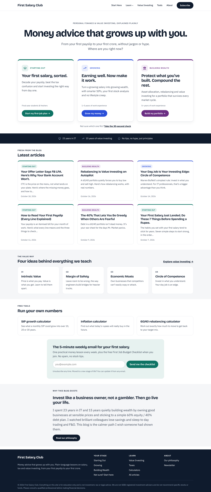

# The Wealth Journal

The WordPress theme (Stages Finance) and companion plugin (Life Stages) behind The Wealth Journal, a personal finance and value investing blog that serves three life stages:

| Stage | Who it's for |
|---|---|
| **Starting Out** | Final-year students and freshers |
| **Growing** | 1–5 years of work experience |
| **Building Wealth** | 5+ years of work experience |

## Live demo

**[Open the live demo in WordPress Playground](https://playground.wordpress.net/?blueprint-url=https://raw.githubusercontent.com/somasundarampalanisamy-lab/the-wealth-journal/main/blueprint.json)**

The demo runs a private, temporary copy of WordPress in your browser, with the theme, plugin and all sample content installed. It takes about 30 seconds to load. You're logged in as an admin, so you can explore the dashboard and editor too. Nothing you change is saved.

## What's inside

- **`stages-finance/`**: the block theme. It includes the homepage with three stage cards, stage-coloured article cards, single post, page and archive templates, and editable header and footer patterns. Fonts are bundled locally.
- **`life-stages/`**: the plugin. It adds the *Stage* taxonomy, learning paths, the "Next step in your stage" card, stage-tagged newsletter forms, SIP, inflation and 60/40 rebalancing calculators, and a one-click sample content importer.

## Install on your own site

1. Download this repository (**Code → Download ZIP**) and unzip it.
2. Zip the `stages-finance` folder on its own, then upload it in **Appearance → Themes → Add New → Upload** and activate it.
3. Zip the `life-stages` folder on its own, then upload it in **Plugins → Add New → Upload** and activate it.
4. Click **Set up sample content → Import sample content**.
5. In **Settings → Life Stages**, paste one newsletter form URL per stage (for example, Kit forms that add the matching stage tag).

Ready-made zips are attached to each [release](../../releases).

## Disclaimer

The sample content is educational and is not investment, tax or legal advice. Tax rules change with each Union Budget.

## License

GPL-2.0-or-later. Bundled fonts (Bricolage Grotesque and IBM Plex Sans) are under the SIL Open Font License.
